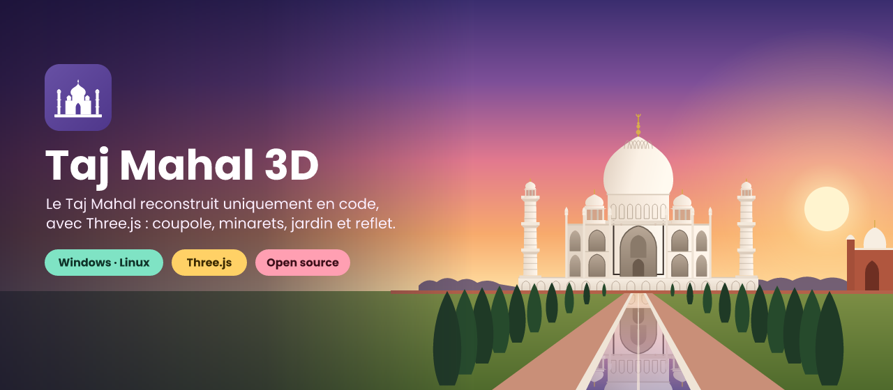
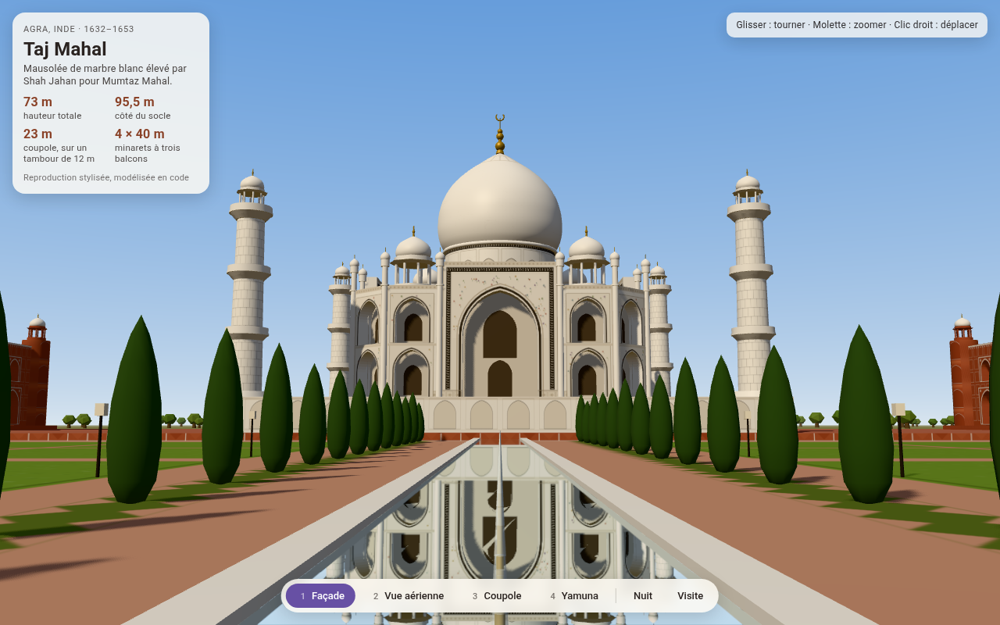
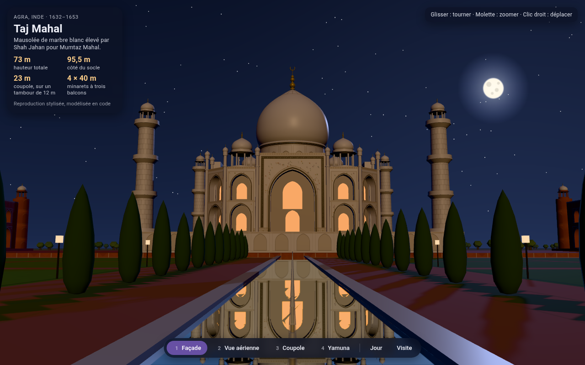
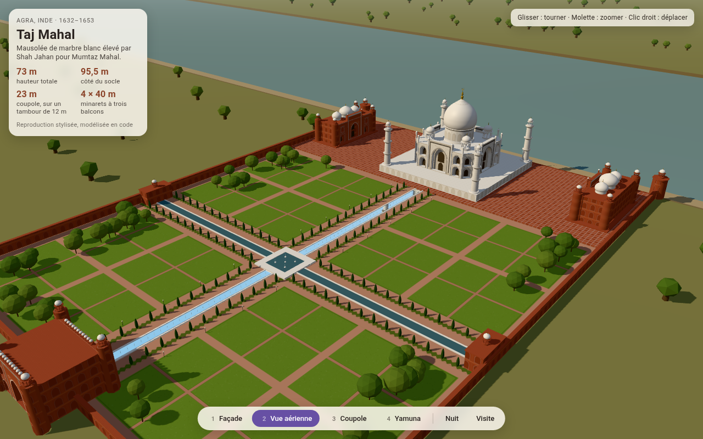
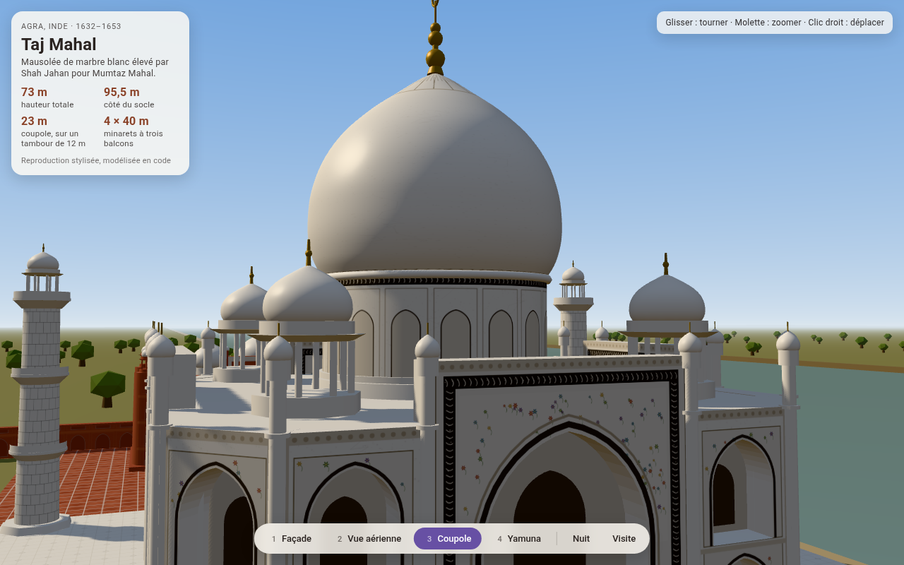
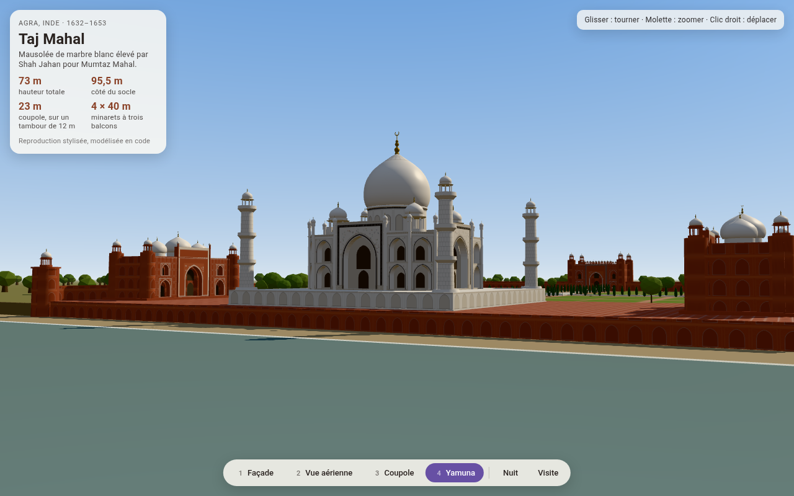

<p align="center">
  
</p>

<p align="center">
  
  
  
  
</p>

<p align="center"><b>Le Taj Mahal, sa coupole, ses minarets et son jardin moghol, reconstruits uniquement en code.</b><br>
Tourner autour, zoomer, changer de point de vue, passer du jour à la nuit.</p>

<p align="center"><a href="https://github.com/JulesROGUE/taj-mahal-3d/releases/latest"><b>⬇️ Télécharger (Windows / Linux)</b></a></p>

---

## L'idée

Le défi : reproduire le Taj Mahal **sans aucun modèle 3D ni texture téléchargés**. Tout est construit en JavaScript avec des géométries Three.js (extrusions percées d'arcs, `LatheGeometry` pour les bulbes, cylindres, tores…) et des textures dessinées dans des `canvas` (marbre, bandes calligraphiques stylisées, fleurs de pietra dura, grès rouge, plan du jardin).

Le projet a été réalisé **avec l'aide de l'IA**, en calant le modèle sur des **images de référence réelles** (photos, coupe et plans de Wikimedia Commons) et sur les dimensions publiées : socle de 95,5 m, mausolée de 57,3 m aux angles chanfreinés, coupole de 23 m sur un tambour de 12 m, épi de 9,6 m, 73 m de hauteur totale, minarets de plus de 40 m à trois balcons. Le résultat est une reproduction **stylisée**, pas un relevé d'architecte.

## Aperçu

<p>
  
  
</p>
<p>
  
  
</p>
<p>
  
</p>

## Références visuelles

Les images ci-dessous ont servi à **mesurer et comparer** (proportions, nombre d'arcs, silhouettes, couleurs). Elles ne sont **pas redistribuées** dans ce dépôt : seuls les liens sont donnés.

| Image (Wikimedia Commons) | Ce qu'on en a tiré |
|---|---|
| [Taj Mahal - South Facade (2014)](https://commons.wikimedia.org/wiki/File:Taj_Mahal_-_South_Facade_-_Agra_2014-05-14_3791.JPG) | Largeur du pishtaq (~22,6 m) et de son arc (14 m), deux niveaux d'arcs par travée et par pan coupé, position des minarets (~4,7 m des angles du socle), tambour à peine plus étroit que le bulbe |
| [Taj Mahal (south view, 2006)](https://commons.wikimedia.org/wiki/File:Taj_Mahal_(south_view,_2006).jpg) | Cadrage du point de vue « Façade », canal et reflet, rangées de cyprès, allées de grès rose |
| [Section of Taj Mahal](https://commons.wikimedia.org/wiki/File:Section_of_Taj_Mahal_(2).jpg) | Coupe à l'échelle : façade de ~21,5 m au-dessus du socle, bulbe large d'environ 27 m, chhatris à ~17,5 m de l'axe |
| [Taj floorplan](https://commons.wikimedia.org/wiki/File:Taj_floorplan.svg) | Plan octogonal irrégulier, pans coupés, profondeur des niches |
| [Taj site plan](https://commons.wikimedia.org/wiki/File:Taj_site_plan.png) | Terrasse côté rivière (~300 × 111 m), jardin carré de ~300 m, grande porte au sud, Yamuna au nord |
| [Aerial view of the Taj Mahal (Wellcome)](https://commons.wikimedia.org/wiki/File:Aerial_view_of_the_Taj_Mahal,_India_Wellcome_V0037711.jpg) | Bassin central surélevé, axes du jardin, arbres en bordure |
| [Jawab at the East of Taj Mahal](https://commons.wikimedia.org/wiki/File:Jawab_at_the_East_of_Taj_Mahal,_Agra.jpg) | Mosquée et jawab : grès rouge, cadres de marbre blanc, trois coupoles blanches, tours d'angle à chhatri |
| [Darwaza-i rauza](https://commons.wikimedia.org/wiki/File:Darwaza-i_rauza,_as_seen_from_the_Taj_Mahal.JPG) | Grande porte, rangée de petits chhatris, tours d'angle, allées et plates-bandes |
| [Taj Mahal at Sunset](https://commons.wikimedia.org/wiki/File:Taj_Mahal_at_Sunset_(14029167044).jpg) | Point de vue « Yamuna », silhouette depuis le nord |

**Comparaison et corrections après le premier rendu** : cyprès moins hauts et plus espacés, allées de grès élargies le long du canal, caméra « Façade » abaissée à hauteur d'yeux pour retrouver le socle, bulbe aux épaules plus pleines et tambour élargi (rapport ~0,88 comme sur les photos), fleurs de pietra dura plus petites et plus sourdes, reflet du bassin éclairci.

## Ce qui est modélisé

| Élément | Construction | Dimensions retenues |
|---|---|---|
| Socle | Boîte de marbre, arcature aveugle (texture canvas), dallage | 95,5 × 95,5 m, sommet à 7 m |
| Mausolée | 4 façades + 4 pans coupés en `ExtrudeGeometry` percés d'arcs brisés, noyau octogonal | 57,3 m de côté, 21,5 m de haut |
| Pishtaq (grand arc) | Façade surélevée, bande calligraphique et pietra dura dessinées en canvas, claustra au fond | 22,6 m de large, 33 m au-dessus du jardin, arc de 14 m |
| Tambour | Cylindre à 16 niches aveugles, moulure en torsade | 12 m de haut, 24,4 m de diamètre |
| Coupole | `LatheGeometry` (profil en bulbe), pétales de lotus au sommet | 23 m de haut, ~27,7 m de large |
| Épi | Sphères empilées et croissant dorés | 9,6 m, sommet à 73 m |
| Chhatris | Kiosques octogonaux à 8 colonnes, auvent et petit bulbe (× 4 en diagonale) | à 17,5 m de l'axe |
| Pinacles (guldastas) | 16 colonnettes coiffées d'un lanterneau | ~28 m au-dessus du socle |
| Minarets | 3 fûts tronconiques, 3 balcons en encorbellement, chhatri sommital | 40 m, balcons à 10,5 / 21 / 31,5 m |
| Mosquée et jawab | Façade de grès rouge percée d'arcs, 3 coupoles de marbre, 4 tours d'angle | 56 × 23 m, à 128 m de l'axe |
| Jardin (charbagh) | Plan dessiné en canvas : 4 quarts, 16 parterres par quart, axes en croix | 300 × 300 m |
| Canaux et bassin | Bassin réfléchissant (`Reflector`), bassin central surélevé à 5 fontaines, jets | canal de 6 m |
| Grande porte | Façades percées d'arcs, 2 × 11 petits chhatris, 4 tours d'angle | 41 × 34 m, 23 m |
| Contexte | Terrasse de grès, mur de quai, Yamuna, arbres, ciel en dégradé, lune et étoiles | — |

Les pièces sont regroupées par matériau avec `mergeGeometries` : une trentaine de meshes (un par matériau) pour toute la scène. Le rendu se fait **à la demande** (au chargement, quand la caméra bouge et pendant les transitions), sans boucle permanente.

## Commandes

| Action | Souris / clavier |
|---|---|
| Tourner | Glisser avec le bouton gauche |
| Zoomer | Molette |
| Déplacer | Clic droit + glisser |
| Points de vue | Touches **1** Façade · **2** Vue aérienne · **3** Coupole · **4** Yamuna (ou boutons en bas) |
| Jour / nuit | Touche **N** ou bouton « Nuit » / « Jour » |
| Visite guidée | Touche **V** ou bouton « Visite » (s'arrête dès qu'on touche la scène) |

Les points de vue s'ouvrent aussi par l'adresse : `#facade`, `#aerien`, `#coupole`, `#yamuna`.

## Installation

Téléchargez la dernière version sur la page [Releases](https://github.com/JulesROGUE/taj-mahal-3d/releases/latest).

**Windows** : téléchargez l'exécutable portable `Taj.Mahal.3D-1.0.0-portable.exe` et lancez-le directement, sans installation.
> L'exécutable n'est pas signé : Windows SmartScreen peut afficher « Windows a protégé votre ordinateur ». Cliquez sur **Informations complémentaires** puis **Exécuter quand même**.

**Linux** :
- **AppImage** : `chmod +x Taj.Mahal.3D-1.0.0-linux-x86_64.AppImage` puis lancez le fichier ;
- **.deb** (Debian, Ubuntu…) : `sudo apt install ./Taj.Mahal.3D-1.0.0-linux-amd64.deb`.

## Développement

```bash
npm install
npm start        # lance l'application en développement
npm run dist     # construit les exécutables avec electron-builder
```

| Brique | Rôle |
|---|---|
| [Three.js](https://threejs.org/) 0.187.0 | Rendu WebGL, géométries, OrbitControls, Reflector |
| Electron | Application de bureau Windows / Linux |
| React 19 + Vite | Surcouche (carte, boutons) et build |
| electron-builder + GitHub Actions | Exécutable portable Windows, AppImage et .deb à chaque tag |

Organisation du code :

```
src/
  scene/   renderer, caméra, lumières, ciel, sol, ambiance jour/nuit
  model/   dimensions (avec sources), socle, mausolée, coupole, minarets,
           mosquée et jawab, grande porte, jardin, textures canvas
  ui/      surcouche HTML
  viewpoints.js
```

## Sources

- [Taj Mahal — Wikipédia (en)](https://en.wikipedia.org/wiki/Taj_Mahal) : dimensions du socle, du mausolée, du pishtaq, de la coupole, du tambour, de l'épi et des minarets ; dates (1631–1653) ; matériaux.
- [Taj Mahal — Archnet](https://archnet.org/sites/1557) : disposition des chhatris, des minarets et des bâtiments latéraux.
- [Taj Mahal — Designing Buildings Wiki](https://www.designingbuildings.co.uk/wiki/Taj_Mahal) : hauteur totale, socle, matériaux.
- Les images de référence listées plus haut (Wikimedia Commons).

## Licence

Code sous licence **MIT** © Jules ROGUE. Police Roboto sous licence SIL Open Font License (OFL).

Il s'agit d'une **reproduction stylisée et non officielle**, réalisée à titre de démonstration technique, sans lien avec le monument ni avec l'organisme qui le gère. Aucun modèle 3D, aucune photo et aucune texture externes ne sont inclus.
